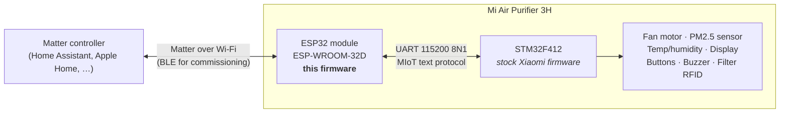
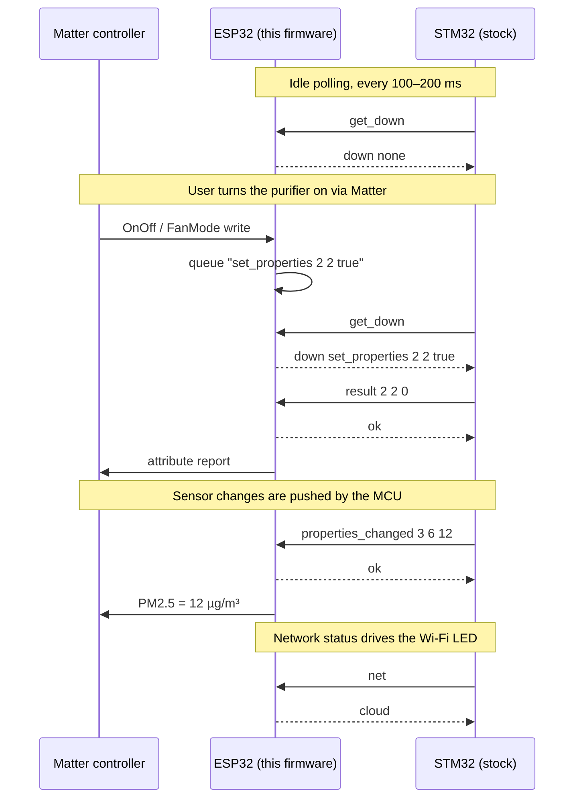
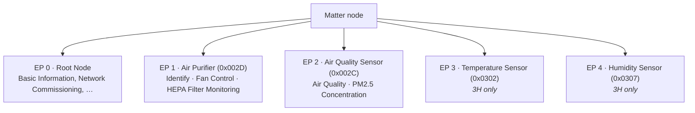
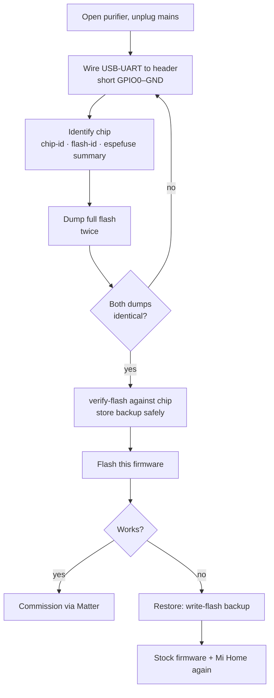

# esp32-xiaomi-air-purifier-matter

Cloud-free [Matter](https://csa-iot.org/all-solutions/matter/) firmware for the
**Xiaomi Mi Air Purifier 3H** and **Mi Air Purifier 3C**. One firmware image
covers both: it detects which purifier it's in.

The firmware replaces the stock firmware on the purifier's built-in ESP32
Wi-Fi module. The ESP32 then joins your Matter fabric directly (Apple Home,
Google Home, Home Assistant, SmartThings, …) instead of talking to the Xiaomi
cloud. No extra hardware or soldering is required.

> **Status: first firmware written, not yet tried on a real purifier.** The
> protocol and Matter mapping are covered by host tests and the firmware
> builds in CI, but the hardware facts it relies on (pins, single core, MAC
> quirk, heartbeat) are still unverified. Do the backup first and expect to
> restore it. See [docs/PLAN.md](docs/PLAN.md) for what's done and what's next.

---

## Contents

- [Supported purifiers](#supported-purifiers)
- [How it works](#how-it-works)
- [Hardware](#hardware)
- [MCU ↔ ESP32 serial protocol](#mcu--esp32-serial-protocol)
- [Matter data model](#matter-data-model)
- [Software stack](#software-stack)
- [Backup, flashing and restore](#backup-flashing-and-restore)
- [Building](#building)
- [Roadmap](#roadmap) (details in [docs/PLAN.md](docs/PLAN.md))
- [Credits and references](#credits-and-references)
- [Disclaimer](#disclaimer)

---

## Supported purifiers

| Purifier | Model IDs | Status | Hardware notes |
|---|---|---|---|
| Mi Air Purifier 3 / 3H | `zhimi.airpurifier.mb3` | Primary target | [esphome-miot 3H wiki](https://github.com/dhewg/esphome-miot/wiki/Xiaomi-Mi-Air-Purifier-3H) |
| Mi Air Purifier 3C | `zhimi.airp.mb4a`, `zhimi.airpurifier.mb4` | Supported in code; property table and fan presets to verify on a unit | [esphome-miot 3C wiki](https://github.com/dhewg/esphome-miot/wiki/Xiaomi-Mi-Air-Purifier-3C) |

The firmware picks the right property table by itself:

- The purifier's controller announces its model when it starts up.
- If it doesn't (for example after only the ESP32 restarted), the firmware
  asks for one property each model has and the other doesn't.
- The detected model is remembered, so later boots start straight away.

A build can also force a model with `idf.py -DPURIFIER_MODEL=1 build` (3H)
or `-DPURIFIER_MODEL=2` (3C).

What differs between the two in Matter:

| | 3H | 3C |
|---|---|---|
| Low / Medium / High | the purifier's manual levels 1–3 | favorite mode at fixed speeds (800 / 1400 / 2200 rpm, to tune) |
| Fine speed 1–15 | favorite levels 0–14 | favorite speed 300–2200 rpm |
| Air-quality level | the purifier's own reading | worked out from PM2.5 |
| Temperature, humidity | yes | no (the 3C has no such sensor) |

## How it works

Both purifiers contain two microcontrollers (3H shown):



- The **STM32F412** runs Xiaomi's stock firmware and does all the real work:
  motor control, sensors, display, buttons, buzzer and filter RFID. We
  **never touch it**.
- The **ESP32** is only a network gateway. Stock, it bridges the MCU to the
  Xiaomi cloud using the text-based *MIoT serial protocol*. This project
  replaces that firmware with one that speaks the same serial protocol to
  the MCU and exposes the device as a Matter Air Purifier.

Because the MCU keeps its stock firmware, fan control, safety logic and the
physical buttons behave exactly as before.

Other Xiaomi purifiers with an ESP32 gateway and a separate MCU use the same
protocol with different property IDs, and can be added as another property
table in `main/purifier_model.cpp`.

## Hardware

| Item | Detail |
|---|---|
| Gateway module | Espressif **ESP-WROOM-32D** (classic ESP32, Wi-Fi + BLE 4.2, no 802.15.4 radio) |
| Main MCU | **STM32F412** |
| MCU link | ESP32 `GPIO17` = TX, `GPIO16` = RX, 115200 baud, 8N1 |
| Flash header | `3.3V`, `GND`, `TX`, `RX`. On the 3H a `GPIO0` / `GND` pin pair sits right above it; **on the 3C GPIO0 isn't on the header** and has to be shorted to GND on the module itself |
| MAC address | The MAC eFuse checksum is **invalid** (confirmed on a 3H), so the build ignores it; the MAC itself reads fine |
| Cores | **Single core** (ESP32 rev 1.0, confirmed on a 3H) |
| Flash size | **4 MB**, no flash encryption or secure boot (confirmed on a 3H) |

Both purifiers use the same module and MCU link. The cores, flash and MAC
rows are confirmed on a 3H from its stock backup (see
[dump/README.md](dump/README.md), which also has Xiaomi's stock partition
table); the pins and serial link come from community reverse engineering (see
[Credits](#credits-and-references)) and are confirmed once our firmware talks
to the MCU.

Disassembly is the same as for the other Xiaomi tower purifiers: remove the
filter, undo the screws inside the filter compartment and at the top, then
lift off the top cover to reach the controller board. There's a
[3H disassembly video](https://www.youtube.com/watch?v=_rC2a6l0M2k). Board
photos, pinouts and model-specific notes:

- 3H: [esphome-miot wiki — Xiaomi Mi Air Purifier 3H](https://github.com/dhewg/esphome-miot/wiki/Xiaomi-Mi-Air-Purifier-3H)
- 3C: [esphome-miot wiki — Xiaomi Mi Air Purifier 3C](https://github.com/dhewg/esphome-miot/wiki/Xiaomi-Mi-Air-Purifier-3C)

## MCU ↔ ESP32 serial protocol

The protocol is Xiaomi's *MIoT serial communication*. Here is a translated
copy of the [official spec](https://github.com/blakadder/miot).

- ASCII text commands; tokens are separated by spaces and each line ends with `\r` (0x0D).
- Maximum line length is 512 bytes.
- **The MCU is the master.** It polls the module with `get_down` every
  100–200 ms. The module answers each line it receives and never speaks
  first.



Commands the module must handle:

| From MCU | Meaning | Reply |
|---|---|---|
| `get_down` | Poll for a queued command | `down none` or `down <get_properties\|set_properties\|action> …` |
| `properties_changed <siid> <piid> <value> …` | Property report | `ok` |
| `event_occured <siid> <eiid> …` | Event report | `ok` |
| `result <siid> <piid> <code> [value] …` | Result of a queued get/set/action | `ok` |
| `net` | Ask for network state (drives the Wi-Fi LED) | `offline` / `unprov` / `uap` / `local` / `cloud` |
| `time [posix]` | Ask for current time | Time string |
| `mac` | Ask for MAC | MAC |
| `model <model>` | Report model | `ok` |
| `mcu_version <nnnn>` | Report MCU firmware version | `ok` |
| `error "<msg>" <code>` | MCU-side error | `ok` |
| `restore` | Factory reset request | `ok` |
| anything else | Unknown | `error` |

The stock gateway is reported to write a periodic heartbeat to property
`13.9` (3H) or `9.4` (3C). We'll confirm this from a UART capture of the
stock firmware before relying on it.

## Matter data model

The device is a Matter **Air Purifier** that uses the **Fan Control** cluster
for power, modes and speed. There's no separate On/Off cluster. The full
feature → cluster mapping, Fan Control configuration and value conversions are
in [docs/PLAN.md](docs/PLAN.md#feature--matter-cluster-mapping).



| Purifier feature | Matter |
|---|---|
| Power, Auto, Low / Medium / High | Fan Control `FanMode` Off / Auto / Low / Medium / High |
| Favorite mode (15 steps) | Fan Control `SpeedSetting` / `PercentSetting` |
| Sleep mode | Fan Control `WindSetting` = SleepWind |
| Motor speed | Fan Control `PercentCurrent` / `SpeedCurrent` |
| Filter life, used time, reset | HEPA Filter Monitoring |
| AQI level, PM2.5 | Air Quality, PM2.5 Concentration Measurement |
| Temperature, humidity (3H) | Temperature / Relative Humidity Measurement |
| Device fault | General Diagnostics active hardware faults (in Home Assistant: the "Hardware faults" problem sensor, disabled by default) |

Child lock, buzzer and display brightness aren't exposed; they stay
controllable on the device itself. Property IDs come from Xiaomi's published
MIoT specs for [`zhimi.airpurifier.mb3`](https://home.miot-spec.com/spec/zhimi.airpurifier.mb3)
and [`zhimi.airp.mb4a`](https://home.miot-spec.com/spec/zhimi.airp.mb4a).

## Software stack

Same stack as
[psytraxx/esp32-homecontrol-matter](https://github.com/psytraxx/esp32-homecontrol-matter),
so tooling, conventions and lessons learned carry over:

| | |
|---|---|
| Language | C++ on **native ESP-IDF** (`app_main()`, no Arduino, no ESPHome) |
| ESP-IDF | **v6.1** (`idf: ">=6.1.0,<6.2.0"` in `main/idf_component.yml`) |
| Matter | **`espressif/esp_matter` 1.6.x** managed component; endpoints built with the `esp_matter::endpoint::*::create()` C++ API |
| Target | **`esp32`** (classic Xtensa). Install the toolchain with `./install.sh esp32`. |
| Wi-Fi security | **WPA2** (also on mixed WPA2/WPA3 networks). WPA3 is switched off because the module failed the key handshake on a mixed network; pure WPA3 networks can't be joined. |
| Transport | **Matter over Wi-Fi**, BLE (NimBLE) for commissioning only. The classic ESP32 has no 802.15.4 radio, so Thread isn't possible and no Thread Border Router is needed. |
| Power model | Mains powered and always on: no ICD, no deep sleep (unlike the plant monitor) |
| Partitions | Custom 4 MB table, single factory app plus NVS. The 1.4 MB firmware would fit two OTA slots; until that's decided (D3), updates are by serial flash. |
| Pairing code | Per-build discriminator, passcode and SPAKE2+ verifier in `main/chip_project_config.h`, generated with `tools/spake2p_verifier.py` |
| Tests | Host-native [Unity](https://github.com/ThrowTheSwitch/Unity) tests in `test/` for the hardware-free logic: MIoT line parser, command queue, MIoT ↔ Matter value conversions |
| CI | GitHub Actions: `espressif/esp-idf-ci-action` build (`-Werror`) for `esp32` plus the native test job |
| Housekeeping | `CHANGELOG.md` (dated, plain language), `CLAUDE.md` agent guide, Renovate |

The MIoT UART protocol handling is written from scratch against the Xiaomi
spec. No ESPHome or ESPHome components are used.

Board-specific differences from the plant monitor:

- **Custom MAC in eFuse.** If the MAC CRC really doesn't validate, the
  default MAC read fails and we need `CONFIG_ESP_MAC_IGNORE_MAC_CRC_ERROR=y`.
  `espefuse summary` during the backup step will tell.
- **Possibly single core.** Use `CONFIG_FREERTOS_UNICORE=y` until
  `esptool chip-id` proves the module is dual-core.
- **Code-driven clusters.** In esp_matter 1.6, measurement clusters such as
  Temperature and Relative Humidity are served by cluster objects.
  `attribute::update()` on them is silently ignored, so values have to be set
  through the cluster (`SetMeasuredValue()`), and every endpoint needs a real
  Min/MaxMeasuredValue range. See the plant monitor's `matter_setup.cpp`.
  Check the same for PM2.5, Air Quality and HEPA Filter Monitoring.
- **Endpoint IDs are append-only.** New endpoints go at the end so
  already-paired controllers keep their mappings.

### Code layout

```
main/
  app_main.cpp            boot order: boot_diag → purifier link → model → Matter
  app_config.h            tunables (poll/heartbeat intervals, timeouts, SNTP)
  board_pins.h            MCU link: UART2, TX GPIO17, RX GPIO16
  miot_protocol.h/.cpp    MIoT values, tokenizer                       (host-tested)
  miot_queue.h/.cpp       commands waiting for the MCU's get_down       (host-tested)
  miot_session.h/.cpp     one MCU line in → one reply out               (host-tested)
  purifier_model.h/.cpp   3H/3C property tables + MIoT ↔ Matter conversions (host-tested)
  purifier_link.h/.cpp    UART driver, link task, poll + heartbeat
  matter_setup.h/.cpp     node, endpoints, Fan Control/HEPA delegates, state → clusters
  chip_project_config.h   pairing identity, Basic Information strings
  boot_diag.h/.cpp        reset reason, boot-loop guard (from the plant monitor)
test/                     host-native Unity tests
tools/mcu_sim.py          3H/3C STM32 simulator for testing on any ESP32 board
tools/spake2p_verifier.py pairing-code verifier generator
partitions_4mb.csv
sdkconfig.defaults
```

## Backup, flashing and restore

> ⚠️ **Never skip the backup.** The full flash dump is the only way back to the
> stock firmware and Mi Home. Xiaomi doesn't publish the firmware, and dumps
> from other units won't work: each one carries device-specific identity and
> keys.



### What you need

- A **3.3 V** USB-UART adapter (CP2102, CH340, FT232, …). **Never use 5 V**
  on the header.
- Ideally a separate **3.3 V supply (≥ 1 A)** for the board, sharing GND with
  the adapter. The board's 3.3 V rail can drag a weak adapter regulator down
  far enough to reset the adapter (it drops off USB, or esptool reports
  `No serial data received`).
- Four jumper wires, plus one more (or a jumper cap) for `GPIO0`–`GND`.
- `esptool` and `espefuse`. Both ship with ESP-IDF; alternatively install
  them with `pip install esptool`. The commands below use the esptool v5
  syntax (`read-flash`); older v4 releases spell them with underscores
  (`read_flash`).
- Every esptool command below passes `--after no-reset`. Without it esptool
  resets the chip when it finishes, the chip leaves bootloader mode, and the
  next command fails until you power-cycle with `GPIO0`–`GND` still
  shorted.

### 1. Connect and enter the bootloader

1. Unplug the purifier from mains and open it (see [Hardware](#hardware)).
2. Wire the header: adapter `GND`→`GND`, `3.3V`→`3.3V`, adapter `TX`→`RX`,
   adapter `RX`→`TX`.
3. Short `GPIO0` to `GND`. On the 3H the pins sit right above the UART
   header. On the 3C GPIO0 isn't brought out: short the module's GPIO0 pin to
   GND directly (see the [3C wiki](https://github.com/dhewg/esphome-miot/wiki/Xiaomi-Mi-Air-Purifier-3C)).
4. Plug the adapter into the computer. This powers the ESP32, which boots
   into the ROM download mode.

> ⚠️ Power the board **only from the UART adapter**. Never have mains
> connected while the adapter is attached.

### 2. Identify the chip and record the eFuses

```bash
esptool --port /dev/ttyUSB0 --after no-reset chip-id
```

```bash
esptool --port /dev/ttyUSB0 --after no-reset flash-id
```

```bash
espefuse --port /dev/ttyUSB0 summary > stock_efuse_summary.txt
```

Note the chip revision, single/dual core, flash size and the MAC address(es).

`espefuse summary` is read-only. **Never run any `espefuse burn-*`
command:** eFuses are one-time programmable and can't be restored. Flashing
never touches the eFuses, so they need no backup, just this record.

### 3. Dump the full flash, twice

```bash
esptool --port /dev/ttyUSB0 --after no-reset --baud 460800 read-flash 0 ALL stock_full_1.bin
```

```bash
esptool --port /dev/ttyUSB0 --after no-reset --baud 460800 read-flash 0 ALL stock_full_2.bin
```

```bash
sha256sum stock_full_1.bin stock_full_2.bin
```

The two hashes must match. If they don't, the connection is unreliable:
lower the baud rate (e.g. `--baud 115200`), shorten the wires, and dump
again. A 4 MB dump should be exactly 4,194,304 bytes.

### 4. Verify the dump against the chip

```bash
esptool --port /dev/ttyUSB0 --after no-reset verify-flash 0 stock_full_1.bin
```

### 5. Optional: inspect the stock partition table

The table lives at offset `0x8000`. Decoding it shows how Xiaomi laid out
the flash (app slots, NVS, factory data):

```bash
dd if=stock_full_1.bin of=stock_partitions.bin bs=1 skip=$((0x8000)) count=$((0xC00))
```

```bash
python "$IDF_PATH/components/partition_table/gen_esp32part.py" stock_partitions.bin
```

### 6. Store the backup safely

Keep `stock_full_1.bin`, its SHA-256 hash and `stock_efuse_summary.txt`
together, in at least two places (e.g. a local disk and a private cloud
folder).

> 🔒 **The dump is private.** It contains your Xiaomi device identity (DID,
> keys, cloud token) and your home Wi-Fi credentials. Never commit it to a
> repository, attach it to an issue or share it.

### 7. Flash this firmware

First erase the whole flash, with the module still in bootloader mode. Xiaomi
uses a different layout (see [dump/README.md](dump/README.md)); erasing
removes its Wi-Fi settings and device identity, which our firmware would
otherwise leave lying in flash. Only do this once the backup is verified:

```bash
esptool --port /dev/ttyUSB0 --after no-reset erase-flash
```

Then either build and flash it yourself (see [Building](#building)):

```bash
idf.py -p /dev/ttyUSB0 flash monitor
```

or flash the image CI built: download the `firmware-esp32` artifact from the
latest successful **Firmware** run on GitHub and write the merged image at
offset 0:

```bash
esptool --port /dev/ttyUSB0 --after no-reset --baud 460800 write-flash 0 air_purifier_matter_merged.bin
```

The pairing code is set per build in `main/chip_project_config.h`. The CI
image uses the code committed there, so anyone with that image shares the
same code; build your own to change it.

Then remove the `GPIO0`–`GND` short and power-cycle the board by unplugging
and replugging the adapter. The serial log prints the Matter QR code and
manual pairing code. Close the purifier, plug it into mains and commission
it from your Matter controller.

### Restore the stock firmware

1. Open the purifier, wire the UART and short `GPIO0`–`GND` as in step 1.
2. Write the backup back:

   ```bash
   esptool --port /dev/ttyUSB0 --after no-reset --baud 460800 write-flash 0 stock_full_1.bin
   ```

   ```bash
   esptool --port /dev/ttyUSB0 --after no-reset verify-flash 0 stock_full_1.bin
   ```

3. Remove the short, power-cycle and reassemble. The module rejoins your
   Wi-Fi with its old settings and shows up in Mi Home as before. If the
   Wi-Fi password has changed since the backup, reset the network on the
   purifier and pair it in Mi Home again.

Writing a full image replaces everything, including the Matter fabrics, so
the controller will show the purifier as unavailable. Remove it there.

### Troubleshooting

| Symptom | Likely cause / fix |
|---|---|
| `Failed to connect to ESP32: No serial data received` | TX/RX swapped, `GPIO0` not shorted *while powering on*, or wrong port. Swap TX/RX, re-short `GPIO0`, replug. |
| Dumps differ between runs | Unreliable link: lower `--baud`, use shorter wires, try another adapter. |
| Board resets or browns out (`brownout detector was triggered`) | The adapter's 3.3 V regulator can't supply Wi-Fi current peaks. Fine for flashing; for test runs use an adapter with a stronger 3.3 V rail. |
| Wi-Fi joins and drops again within a fraction of a second (`run -> init` in the log, repeating) | Look for the `wifi: Disconnected from ...` line: it names the reason and suggests a fix. Usually the key handshake fails. The firmware joins with WPA2; make sure the network offers WPA2 (WPA2-only or WPA2/WPA3 mixed) and not WPA3 only. If it still fails, turn off 802.11r (fast roaming) and set PMF to optional on the 2.4 GHz network. |
| USB adapter disappears when the board's 3.3 V is connected | The board pulls the adapter's regulator down. Power the board from a separate 3.3 V supply (≥ 1 A) with GND shared, and leave the adapter's 3.3 V pin unconnected. |
| The second esptool command can't connect | esptool reset the chip out of bootloader mode. Use `--after no-reset`, or power-cycle with `GPIO0`–`GND` still shorted. |
| Our firmware boot-loops or won't commission | Capture the log with `idf.py monitor`, then restore the backup if needed. |
| Purifier runs but its Wi-Fi LED blinks or shows an error | The MCU isn't getting the expected `net` reply. This is a firmware bug: restore the backup and report it. |
| Worried the module is bricked | The ESP32's ROM bootloader is in mask ROM and can't be overwritten. As long as `GPIO0` can be pulled low at power-on, the stock backup can always be written back. |

The purifier itself (STM32 and physical buttons) should keep working even
while the ESP32 firmware is broken, because only the network side is
affected.

## Building

```bash
git clone -b v6.1 --recursive https://github.com/espressif/esp-idf.git ~/.espressif/v6.1/esp-idf
```

```bash
~/.espressif/v6.1/esp-idf/install.sh esp32
```

```bash
source ~/.espressif/v6.1/esp-idf/export.sh
```

```bash
idf.py set-target esp32
```

```bash
idf.py build
```

```bash
idf.py -p /dev/ttyUSB0 flash monitor
```

```bash
cmake -S test -B test/build && cmake --build test/build && ./test/build/test_logic
```

For flashing, the module must be in bootloader mode (`GPIO0`↔`GND` shorted)
and powered from the UART adapter. See
[Backup, flashing and restore](#backup-flashing-and-restore).

### Testing without the purifier

`tools/mcu_sim.py` plays the purifier's STM32 on a serial port, so the
firmware can run on any ESP32 dev board. Wire a second USB-UART adapter to
the board's MCU-link pins (adapter TX → GPIO16, adapter RX → GPIO17, GND →
GND), flash the firmware, then:

```bash
pip install pyserial
```

```bash
python3 tools/mcu_sim.py --port /dev/ttyUSB1
```

That plays a 3H; add `--model mb4` for a 3C. With `--silent-model` it doesn't
announce its model, so the firmware has to tell the models apart by itself.

The simulator polls the firmware like the real MCU, answers its commands,
drifts its sensors and reports changes. Type `power`, `mode 2`, `fav 9`
(a level on the 3H, an rpm such as `fav 1250` on the 3C), `pm 80`,
`filter 5`, `restore` or `state` to act like a user at the purifier.
Commission the board with the pairing code from the console log and watch
the changes arrive in your controller, and vice versa.

## Roadmap

Checked items are written and host-tested but not yet run on a purifier.
The detailed phase plan, decisions and risks are in [docs/PLAN.md](docs/PLAN.md).


- [ ] Back up a unit; confirm chip variant (single/dual core), flash size, eFuse MAC and stock partition table
- [ ] Capture a stock MCU↔ESP32 UART log (boot, button presses, app commands, heartbeat)
- [x] Project skeleton on the plant-monitor stack (ESP-IDF 6.1, esp_matter 1.6, `esp32`, 4 MB single-app partitions, CI, Unity tests, CHANGELOG)
- [x] MIoT UART driver: line framing, `get_down` command queue, `result`/`properties_changed` parsing
- [x] `net` state reporting tied to Matter/Wi-Fi state (correct LED behaviour)
- [x] Air Purifier endpoint: Identify + Fan Control
- [x] HEPA Filter Monitoring incl. reset
- [x] Air Quality, PM2.5, temperature, humidity endpoints
- [x] Factory reset via the purifier's own network reset (`restore`)
- [ ] Matter OTA updates (decision deferred until the binary size is known)
- [x] 3C support: property table, fan presets, model detection
- [ ] First run on a real 3H (bridge behaves like stock)
- [ ] First run on a real 3C; tune its Low/Medium/High speeds
- [ ] Tested with Apple Home, Google Home and Home Assistant

## Credits and references

Specs:

- [Xiaomi MIoT spec for `zhimi.airpurifier.mb3`](https://home.miot-spec.com/spec/zhimi.airpurifier.mb3):
  property and action IDs
- [blakadder/miot](https://github.com/blakadder/miot): English translation of
  Xiaomi's MIoT serial protocol docs

Prior art: community reverse engineering of the 3H that documented the
hardware (chips, header, UART pins and module quirks). This project doesn't
use their code:

- [sourcediver.org: Unclouded purifier](https://sourcediver.org/posts/240218_unclouded_purifier/):
  the write-up that inspired this project
- [Flamingo-tech/xiaomi-air-purifier-reverse-engineering](https://github.com/Flamingo-tech/xiaomi-air-purifier-reverse-engineering):
  3H teardown, ESP-WROOM-32D and STM32F412 identification
- [jaromeyer/mipurifier-esphome](https://github.com/jaromeyer/mipurifier-esphome)
  and [dhewg/esphome-miot](https://github.com/dhewg/esphome-miot): ESPHome-based
  firmwares, the source of the header, pin and module-quirk information. Their
  wiki pages for the [3H](https://github.com/dhewg/esphome-miot/wiki/Xiaomi-Mi-Air-Purifier-3H)
  and [3C](https://github.com/dhewg/esphome-miot/wiki/Xiaomi-Mi-Air-Purifier-3C)
  have board photos and flashing notes
- [python-miio](https://github.com/rytilahti/python-miio): cross-check of the
  3C's property IDs
- [muwave.de: Improving a Xiaomi Air Purifier 3H](https://blog.muwave.de/2025/02/hacking-the-xiaomi-air-purifier-3h-1-3/)

Stack:

- [psytraxx/esp32-homecontrol-matter](https://github.com/psytraxx/esp32-homecontrol-matter):
  sister project on the same ESP-IDF / esp_matter stack
- [esp-matter](https://github.com/espressif/esp-matter),
  [ESP-IDF](https://github.com/espressif/esp-idf),
  [esptool](https://github.com/espressif/esptool)

## Disclaimer

This is an unofficial project, not affiliated with or endorsed by Xiaomi,
Zhimi, Espressif or the Connectivity Standards Alliance. Opening the device
voids its warranty and exposes mains-powered parts, and flashing can brick
the Wi-Fi module. You do this at your own risk.

## License

TBD.


Manual pairing code: 21365748815
QR code payload: MT:A9801KQS02DWBE78Q10