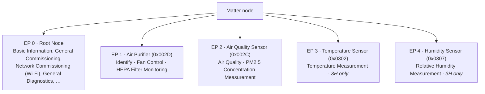

# Matter mapping

How the purifier's MIoT properties map to Matter clusters, and how values are
converted in both directions. The code is in
[main/purifier_model.cpp](../main/purifier_model.cpp) and covered by the host
tests in [test/test_logic/test_model.cpp](../test/test_logic/test_model.cpp).
See the [README](../README.md) for hardware, protocol and flashing.

## Endpoints

Endpoint IDs are append-only: new endpoints go at the end, so paired
controllers keep their mappings.

## Mi Air Purifier 3H

MIoT IDs are `siid.piid` from the
[`zhimi.airpurifier.mb3` spec](https://home.miot-spec.com/spec/zhimi.airpurifier.mb3).

| Purifier feature | MIoT | Endpoint | Matter cluster | Attribute / command |
|---|---|---|---|---|
| Power on/off | 2.2 | 1 | Fan Control | `FanMode` = Off ↔ power off; any other mode ↔ power on |
| Auto mode | 2.5 = 0 | 1 | Fan Control | `FanMode` = Auto (feature **AUT**) |
| Manual level 1 / 2 / 3 | 2.5 = 3, 2.4 = 1/2/3 | 1 | Fan Control | `FanMode` = Low / Medium / High |
| Favorite mode, 15-step speed | 2.5 = 2, 10.10 = 0–14 | 1 | Fan Control | `SpeedSetting` 1–15 / `PercentSetting` (feature **SPD**, `SpeedMax` = 15) |
| Sleep mode | 2.5 = 1 | 1 | Fan Control | `WindSetting` = SleepWind (feature **WND**, `WindSupport` = SleepWind) |
| Current speed | the setting; 10.8 rpm in Auto/Sleep | 1 | Fan Control | `PercentCurrent`, `SpeedCurrent` |
| Filter life | 4.3 (%) | 1 | HEPA Filter Monitoring | `Condition` (`DegradationDirection` = Down) |
| Filter needs replacing | from 4.3 | 1 | HEPA Filter Monitoring | `ChangeIndication` OK / Warning / Critical |
| Filter used time | 4.5 (h) | 1 | HEPA Filter Monitoring | `LastChangedTime` = now − hours used (needs SNTP time) |
| Reset filter | action 4.1 `3 0` | 1 | HEPA Filter Monitoring | `ResetCondition` command |
| Identify | — | 1 | Identify | Accepted and logged; no visible effect |
| Air quality level | 13.8 (0–5) | 2 | Air Quality | `AirQuality` enum |
| PM2.5 | 3.6 (µg/m³) | 2 | PM2.5 Concentration Measurement | `MeasuredValue`, unit µg/m³, medium Air |
| Temperature | 3.8 (°C) | 3 | Temperature Measurement | `MeasuredValue` (0.01 °C) |
| Humidity | 3.7 (%) | 4 | Relative Humidity Measurement | `MeasuredValue` (0.01 %) |
| Fault code | 2.1 | 0 | General Diagnostics | `ActiveHardwareFaults` + `HardwareFaultChange` event: codes 3–5 (sensor errors) → Sensor, other non-zero codes → Unspecified |
| Heartbeat | 13.9 = 60, every 60 s | — | — | Written by the firmware |
| Filter door | 15.5 | — | — | Logged |
| Child lock, buzzer, display brightness | 7.1, 5.1, 6.1 | — | — | Not exposed; controllable on the device |
| Use time, purified volume, average AQI | 12.1, 13.1, 13.2 | — | — | Ignored |

## Fan Control configuration

| Attribute | Value |
|---|---|
| Features | **SPD** (MultiSpeed), **AUT** (Auto), **WND** (Wind) |
| `FanModeSequence` | 2 = Off / Low / Med / High / Auto |
| `SpeedMax` | 15 |
| `WindSupport` | SleepWind |

The Fan Control cluster in esp_matter 1.6 owns the FanMode ↔ Percent ↔ Speed
relationship: writing FanMode Low/Medium/High always yields 33 %/1, 66 %/8 and
100 %/15, and writing a speed or percent derives the other two. The firmware
pushes either a FanMode or a SpeedSetting and lets the cluster fill in the
rest, and recognises a controller's FanMode write by exactly those pairs.

### Matter → 3H

| Controller writes | Sent to MCU (queued `set_properties`) |
|---|---|
| `FanMode` = Off | `2 2 false` |
| `FanMode` = Low / Medium / High | `2 2 true`, `2 5 3`, `2 4 1/2/3` |
| `FanMode` = On | The cluster turns it into High → `2 4 3` |
| `FanMode` = Auto | `2 2 true`, `2 5 0` |
| `SpeedSetting` = 0 / `PercentSetting` = 0 | `2 2 false` |
| `SpeedSetting` = n (1–14) | `2 2 true`, `2 5 2`, `10 10 n−1` |
| `SpeedSetting` = 15 | Same values as `FanMode` = High → manual level 3 |
| `PercentSetting` = p (1–99) | The cluster derives `SpeedSetting` = ⌈15 · p / 100⌉, then as above |
| `WindSetting` = SleepWind | `2 2 true`, `2 5 1` |
| `WindSetting` cleared | `2 5 0` (back to Auto) |

### 3H → Matter

| Purifier state | `FanMode` | `SpeedSetting` / `PercentSetting` | `WindSetting` |
|---|---|---|---|
| Power off | Off | 0 / 0 | none |
| Auto | Auto | null / null | none |
| Sleep | Low | 1 / 33 % | SleepWind |
| Manual level 1 / 2 / 3 | Low / Medium / High | 1 / 33 %, 8 / 66 %, 15 / 100 % | none |
| Favorite level f (0–14) | Low / Medium / High by thirds | f+1 / ⌊(f+1)·100/15⌋ % | none |

### Current speed

`PercentCurrent` is what Home Assistant shows on its fan slider, so it
follows the setting: 0 when off; 33 / 66 / 100 % for Low / Medium / High;
the cluster's `PercentSetting` for a fine speed (or speed·100/15 %). Only in
Auto and Sleep, where the purifier picks the speed, is it the motor rpm:
(rpm − 300) / (2300 − 300) · 100, clamped to 1–100.
`SpeedCurrent` = ⌈15 · PercentCurrent / 100⌉. An accepted set updates the
tracked state at once, without waiting for the MCU's report.

## Other value conversions

| From | To |
|---|---|
| AQI state 0 Best / 1 Good / 2 Normal / 3 Bad / 4 Worse / 5 Unhealthy | `AirQuality` Good / Fair / Moderate / Poor / VeryPoor / ExtremelyPoor |
| Filter life % | `Condition` = %; `ChangeIndication` = OK > 10 %, Warning 1–10 %, Critical 0 % |
| Temperature °C (float) | round(°C × 100) |
| Humidity % | % × 100 |

## Mi Air Purifier 3C

Same module, pins and protocol as the 3H; different property IDs and a
simpler fan. IDs from the
[`zhimi.airp.mb4a` spec](https://home.miot-spec.com/spec/zhimi.airp.mb4a),
cross-checked against python-miio and esphome-miot
([3C wiki](https://github.com/dhewg/esphome-miot/wiki/Xiaomi-Mi-Air-Purifier-3C)).

| Purifier feature | 3C MIoT | 3H MIoT | Matter |
|---|---|---|---|
| Power | 2.1 | 2.2 | Fan Control `FanMode` Off ↔ off |
| Mode | 2.4 (0 Auto, 1 Sleep, 2 Favorite) | 2.5 (+ 3 Manual) | Fan Control `FanMode` / `WindSetting` |
| Fan speed | favorite rpm 9.3 (300–2200, steps of 10) | fan level 2.4, favorite level 10.10 | Fan Control speed / percent |
| Motor rpm | 9.1 | 10.8 | `PercentCurrent` / `SpeedCurrent` |
| PM2.5 | 3.4 | 3.6 | PM2.5 Concentration Measurement |
| Air-quality level | — (derived from PM2.5) | 13.8 | Air Quality |
| Temperature / humidity | — | 3.8 / 3.7 | endpoints 3 / 4 (3H only) |
| Filter life / hours | 4.1 / 4.3 | 4.3 / 4.5 | HEPA Filter Monitoring |
| Reset filter | action 4.1 `3 0` | action 4.1 `3 0` | `ResetCondition` |
| Fault | 2.2 | 2.1 | General Diagnostics `ActiveHardwareFaults` (any non-zero → Unspecified) |
| Heartbeat | 9.4 | 13.9 | — |
| Model probe | answers 9.1 | answers 10.8 | — |

The 3C has no manual levels:

| Controller writes | Sent to the 3C |
|---|---|
| `FanMode` Off / Auto, `WindSetting` SleepWind | as on the 3H, with the 3C's IDs |
| `FanMode` Low / Medium / High | Favorite mode at 800 / 1400 / 2200 rpm |
| `SpeedSetting` n (1–14) | Favorite mode at 300 + (n−1)·1900/14 rpm, rounded to 10 (300, 440, 570 … 2060) |
| `SpeedSetting` 15 | same as High (2200 rpm) |

Reported back: a favorite rpm equal to a preset shows as that FanMode;
any other rpm shows as the nearest speed. The 3C's air-quality level uses
the US EPA PM2.5 breakpoints: ≤12 Good, ≤35.4 Fair, ≤55.4 Moderate,
≤150.4 Poor, ≤250.4 VeryPoor, above that ExtremelyPoor (µg/m³).
