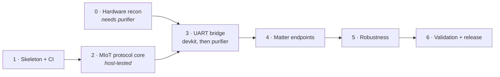
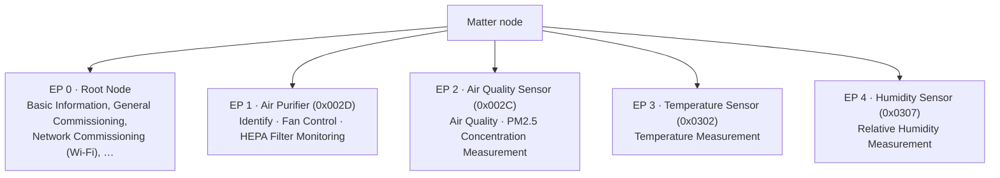

# Implementation plan

How we get from "stock purifier" to "Matter purifier", in phases that each end
in something verifiable. See the [README](../README.md) for hardware, protocol
and backup details.

Phases 1 and 2 don't need the purifier and run in parallel with Phase 0.

## Status

| Phase | State |
|---|---|
| 0 Hardware recon | **Partly done (3H)** — backup taken and verified; single core, 4 MB flash, invalid MAC CRC confirmed ([dump/README.md](../dump/README.md)). Still open: UART capture of the stock firmware, and the 3C |
| 1 Project skeleton | **Done** — builds in CI ([PR #1](https://github.com/psytraxx/esp32-xiaomi-air-purifier-matter/pull/1)) |
| 2 MIoT protocol core | **Done** — host-tested; capture-based fixtures follow Phase 0 |
| 3 UART bridge | **Written** (`purifier_link`, `tools/mcu_sim.py`); devkit and in-purifier tests open |
| 4 Matter endpoints | **Written** (all four endpoints, delegates, echo suppression); controller tests open |
| 5 Robustness | **Partly written** (Wi-Fi LED via `net`, SNTP `time`, `restore` → factory reset, MCU-silence log); reachability flag open |
| 6 Validation + release | CI builds a flashable image; the rest is open |

## Decisions

| # | Topic | Decision |
|---|---|---|
| D1 | Fan / mode control | **Matter Fan Control cluster** for everything fan-related: power, Auto, Low/Med/High, fine speed, Sleep. No separate On/Off cluster, so there's a single source of truth for power. Mapping below. |
| D2 | Child lock, buzzer, display brightness | **Not exposed.** They stay controllable on the device itself. |
| D3 | Matter OTA updates | **Decide later.** Data is in: the first CI build is 1.39 MB, and two OTA slots of 1.875 MB (esp-matter's own 4 MB layout) would leave ~480 KB headroom each. Single-app layout until decided. |
| D4 | Pairing code | **Per build, like the plant monitor**: discriminator, passcode and SPAKE2+ verifier in `main/chip_project_config.h`, generated with `tools/spake2p_verifier.py`. |
| D5 | License | Open |
| D6 | Mi Air Purifier 3C | **Same firmware image as the 3H.** One property table per model; the model is announced by the MCU or told apart by a probe, remembered in NVS, and can be forced at build time. Endpoints 1–2 are identical on both; temperature/humidity (3–4) exist on the 3H only. See [3C mapping](#mi-air-purifier-3c). |

## Feature → Matter cluster mapping

### Endpoints

Endpoint IDs are append-only: new endpoints go at the end.

### Purifier features (3H)

MIoT IDs are `siid.piid` from the
[`zhimi.airpurifier.mb3` spec](https://home.miot-spec.com/spec/zhimi.airpurifier.mb3).
The 3C's are in [Mi Air Purifier 3C](#mi-air-purifier-3c) below.

| Purifier feature | MIoT | Endpoint | Matter cluster | Attribute / command |
|---|---|---|---|---|
| Power on/off | 2.2 | 1 | Fan Control | `FanMode` = Off ↔ power off; any other mode ↔ power on |
| Auto mode | 2.5 = 0 | 1 | Fan Control | `FanMode` = Auto (feature **AUT**) |
| Manual level 1 / 2 / 3 | 2.5 = 3, 2.4 = 1/2/3 | 1 | Fan Control | `FanMode` = Low / Medium / High |
| Favorite mode, 15-step speed | 2.5 = 2, 10.10 = 0–14 | 1 | Fan Control | `SpeedSetting` 1–15 / `PercentSetting` (feature **SPD**, `SpeedMax` = 15) |
| Sleep mode | 2.5 = 1 | 1 | Fan Control | `WindSetting` = SleepWind (feature **WND**, `WindSupport` = SleepWind) |
| Actual motor speed | 10.8 (300–2300 rpm) | 1 | Fan Control | `PercentCurrent`, `SpeedCurrent` |
| Filter life | 4.3 (%) | 1 | HEPA Filter Monitoring | `Condition` (`DegradationDirection` = Down) |
| Filter needs replacing | from 4.3 | 1 | HEPA Filter Monitoring | `ChangeIndication` OK / Warning / Critical |
| Filter used time | 4.5 (h) | 1 | HEPA Filter Monitoring | `LastChangedTime` = now − hours used (needs SNTP time) |
| Reset filter | action 4.1 | 1 | HEPA Filter Monitoring | `ResetCondition` command |
| Identify | display brightness 6.1 | 1 | Identify | `Identify` command → blink display (internal use only) |
| Air quality level | 13.8 (0–5) | 2 | Air Quality | `AirQuality` enum |
| PM2.5 | 3.6 (µg/m³) | 2 | PM2.5 Concentration Measurement | `MeasuredValue`, unit µg/m³, medium Air |
| Temperature | 3.8 (°C) | 3 | Temperature Measurement | `MeasuredValue` (0.01 °C) |
| Humidity | 3.7 (%) | 4 | Relative Humidity Measurement | `MeasuredValue` (0.01 %) |
| Device info | `model`, `mcu_version` | 0 | Basic Information | Product name, software version strings |
| Child lock | 7.1 | — | — | Not exposed (D2) |
| Buzzer | 5.1 | — | — | Not exposed (D2) |
| Display brightness | 6.1 | — | — | Not exposed (D2); used internally for Identify |
| Fault code | 2.1 | 0 | General Diagnostics | `ActiveHardwareFaults` + `HardwareFaultChange` event: codes 3–5 (sensor errors) → Sensor, other non-zero codes → Unspecified |
| Filter door | 15.5 | — | — | Logged |
| Use time, purified volume, average AQI | 12.1, 13.1, 13.2 | — | — | Ignored |

### Fan Control configuration

| Attribute | Value |
|---|---|
| Features | **SPD** (MultiSpeed), **AUT** (Auto), **WND** (Wind) |
| `FanModeSequence` | 2 = Off / Low / Med / High / Auto |
| `SpeedMax` | 15 |
| `WindSupport` | SleepWind |

### Fan Control behaviour: Matter → purifier

| Controller writes | Sent to MCU (queued `set_properties`) |
|---|---|
| `FanMode` = Off | `2 2 false` |
| `FanMode` = Low / Medium / High | `2 2 true`, `2 5 3`, `2 4 1/2/3` |
| `FanMode` = On | The cluster turns it into High → `2 4 3` |
| `FanMode` = Auto | `2 2 true`, `2 5 0` |
| `SpeedSetting` = 0 / `PercentSetting` = 0 | `2 2 false` |
| `SpeedSetting` = n (1–14) | `2 2 true`, `2 5 2`, `10 10 n−1` |
| `SpeedSetting` = 15 | Same values as `FanMode` = High → manual level 3 |
| `PercentSetting` = p (1–99) | The cluster derives `SpeedSetting` = ⌈15 · p / 100⌉, then as above |
| `WindSetting` = SleepWind | `2 2 true`, `2 5 1` |
| `WindSetting` cleared | `2 5 0` (back to Auto) |

### Fan Control behaviour: purifier → Matter

| Purifier state | `FanMode` | `SpeedSetting` / `PercentSetting` | `WindSetting` |
|---|---|---|---|
| Power off | Off | 0 / 0 | none |
| Auto | Auto | null / null | none |
| Sleep | Low | 1 / 33 % | SleepWind |
| Manual level 1 / 2 / 3 | Low / Medium / High | 1 / 33 %, 8 / 66 %, 15 / 100 % | none |
| Favorite level f (0–14) | Low / Medium / High by thirds | f+1 / ⌊(f+1)·100/15⌋ % | none |

The Fan Control cluster in esp_matter 1.6 owns the FanMode ↔ Percent ↔ Speed
relationship: writing FanMode Low/Medium/High always yields 33 %/1, 66 %/8 and
100 %/15, and writing a speed or percent derives the other two. The firmware
pushes either a FanMode or a SpeedSetting and lets the cluster fill in the
rest, and recognises a controller's FanMode write by exactly those pairs.

`PercentCurrent` = (rpm − 300) / (2300 − 300) · 100, clamped to 1–100 while
running and 0 when off. `SpeedCurrent` = ⌈15 · PercentCurrent / 100⌉.

### Other value conversions

| From | To |
|---|---|
| AQI state 0 Best / 1 Good / 2 Normal / 3 Bad / 4 Worse / 5 Unhealthy | `AirQuality` Good / Fair / Moderate / Poor / VeryPoor / ExtremelyPoor |
| Filter life % | `Condition` = %; `ChangeIndication` = OK > 10 %, Warning 1–10 %, Critical 0 % |
| Temperature °C (float) | round(°C × 100) |
| Humidity % | % × 100 |

To verify on hardware:

- What favorite level 0 means on the 3H.
- The 10 % filter warning threshold, which should match the purifier's own display.
- Whether the MCU accepts mode and level in one `set_properties` line or needs separate ones.

### Mi Air Purifier 3C

Same module, pins and protocol as the 3H; different property IDs and a
simpler fan. IDs from the
[`zhimi.airp.mb4a` spec](https://home.miot-spec.com/spec/zhimi.airp.mb4a),
cross-checked against python-miio and esphome-miot
([3C wiki](https://github.com/dhewg/esphome-miot/wiki/Xiaomi-Mi-Air-Purifier-3C)).

| Purifier feature | 3C MIoT | 3H MIoT | Matter |
|---|---|---|---|
| Power | 2.1 | 2.2 | Fan Control `FanMode` Off ↔ off |
| Mode | 2.4 (0 Auto, 1 Sleep, 2 Favorite) | 2.5 (+ 3 Manual) | Fan Control `FanMode` / `WindSetting` |
| Fan speed | favorite rpm 9.3 (300–2200, steps of 10) | fan level 2.4, favorite level 10.10 | Fan Control speed / percent |
| Motor rpm | 9.1 | 10.8 | `PercentCurrent` / `SpeedCurrent` |
| PM2.5 | 3.4 | 3.6 | PM2.5 Concentration Measurement |
| Air-quality level | — (derived from PM2.5) | 13.8 | Air Quality |
| Temperature / humidity | — | 3.8 / 3.7 | endpoints 3 / 4 (3H only) |
| Filter life / hours | 4.1 / 4.3 | 4.3 / 4.5 | HEPA Filter Monitoring |
| Reset filter | action 4.1 `3 0` | action 4.1 `3 0` | `ResetCondition` |
| Fault | 2.2 | 2.1 | General Diagnostics `ActiveHardwareFaults` (3C codes not documented: any non-zero → Unspecified) |
| Heartbeat | 9.4 | 13.9 | — |
| Model probe | answers 9.1 | answers 10.8 | — |

Fan behaviour on the 3C (it has no manual levels):

| Controller writes | Sent to the 3C |
|---|---|
| `FanMode` Off / Auto, `WindSetting` SleepWind | as on the 3H, with the 3C's IDs |
| `FanMode` Low / Medium / High | Favorite mode at 800 / 1400 / 2200 rpm (presets, to tune) |
| `SpeedSetting` n (1–14) | Favorite mode at 300 + (n−1)·1900/14 rpm, rounded to 10 (300, 440, 570 … 2060) |
| `SpeedSetting` 15 | same as High (2200 rpm) |

Reported back: a favorite rpm equal to a preset shows as that FanMode;
any other rpm shows as the nearest speed. The 3C's air-quality level uses
the US EPA PM2.5 breakpoints: ≤12 Good, ≤35.4 Fair, ≤55.4 Moderate,
≤150.4 Poor, ≤250.4 VeryPoor, above that ExtremelyPoor (µg/m³).

To verify on a 3C: that mode 2 is Favorite, the accepted rpm range (some units
reject above 2200), the heartbeat 9.4, whether the MCU announces its model on
its own, and comfortable Low/Medium/High presets.

## Phases

### Phase 0: Hardware recon (needs the purifier; repeat on a 3C)

1. Back up the flash as described in the README: `chip-id`, `flash-id`,
   `espefuse summary`, two `read-flash` dumps with matching SHA-256, then
   `verify-flash`.
2. Decode the stock partition table (size of Xiaomi's app).
3. Capture stock UART traffic on both lines (ESP32 TX and MCU TX), using two
   USB-UART RX pins or a logic analyzer:
   - power-on until the Wi-Fi LED is solid;
   - every button;
   - every Mi Home action (power, each mode, fan level, favorite level,
     sleep, filter reset);
   - a few minutes idle, for the heartbeat, `time` and `net`.

   ⚠️ The purifier is on mains here. Use a laptop on battery and touch only
   the low-voltage header.
4. Share the chip and eFuse output, partition table and capture logs, with
   the DID, token and MAC blanked out. Never share the dump.

**Done when** we know: single or dual core, flash size, whether the MAC CRC
is bad, the boot handshake, the heartbeat, and the MCU's expectations for
`net` and `time`.

### Phase 1: Project skeleton

Mirror [esp32-homecontrol-matter](https://github.com/psytraxx/esp32-homecontrol-matter):

- **Build files:** `CMakeLists.txt` and `main/idf_component.yml` (IDF
  `>=6.1.0,<6.2.0`, `espressif/esp_matter` 1.6.x).
- **`sdkconfig.defaults` for `esp32`:**
  - Wi-Fi station on; Thread, ICD and sleep off;
  - NimBLE, with BLE memory released after commissioning;
  - unicore until Phase 0 says otherwise;
  - MAC CRC ignore prepared but kept off until Phase 0 confirms it;
  - CHIP logging at error level;
  - `CONFIG_ESP_MATTER_MAX_DYNAMIC_ENDPOINT_COUNT`.
- **Partitions:** `partitions_4mb.csv` with a single factory app (D3 later).
- **Pairing (D4):** `chip_project_config.h` and `tools/spake2p_verifier.py`.
- **Code from the plant monitor:** `boot_diag.cpp/.h` (boot-loop guard).
- **Firmware:** `app_main.cpp` brings up a root-node-only, commissionable
  Matter device.
- **CI and project files:** `.github/workflows/build.yaml` (`esp32` build
  with `-Werror`, plus native tests), the `test/` Unity harness, `CLAUDE.md`,
  `CHANGELOG.md`, `renovate.json`, `.clang-format`, `.clangd`, `.gitignore`.

**Done when** CI is green. Record the binary size for D3.

### Phase 2: MIoT protocol core (pure C++, host-tested)

| File | Contents |
|---|---|
| `main/miot_protocol.h` | Line tokenizer (quoted strings, ` ` escapes, 512-byte limit), reply formatter |
| `main/miot_queue.h` | Pending down-command queue: FIFO, per-property merge, timeout when no `result` comes back |
| `main/purifier_model.h` | 3H property table + every conversion in the tables above |
| `main/miot_session.h` | Received line → reply + events; answers `get_down`, `net`, `time`, `model`, `mcu_version`; tracks MCU state |

**Done when** each file has Unity tests, using real Phase 0 capture lines as
fixtures.

### Phase 3: UART bridge

1. **`main/miot_uart.cpp`:** UART on GPIO16 (RX) / GPIO17 (TX), 115200 8N1.
   An RX task assembles `\r`-terminated lines and passes them to
   `miot_session`, which replies within the MCU's timing. Every line is
   logged at debug level.
2. **`tools/mcu_sim.py`:** a host-side STM32 simulator that polls `get_down`
   and replays property changes from the Phase 0 capture. It lets us develop
   against any ESP32 devkit over USB-UART without opening the purifier.
3. **First in-purifier test (bridge only, no Matter endpoints yet):**
   - the purifier runs normally;
   - the buttons work;
   - there are no fault codes;
   - all properties appear in the log;
   - the Wi-Fi LED is sane.

   Restore the backup if anything is off.

**Done when** the purifier runs on our firmware with no difference from stock
except the cloud.

### Phase 4: Matter endpoints

Build them in this order, so endpoint IDs never shift:

1. **EP 1 Air Purifier:** Identify and Fan Control, per the mapping above.
2. **EP 1:** HEPA Filter Monitoring, including `ResetCondition`.
3. **EP 2 Air Quality Sensor:** Air Quality and PM2.5.
4. **EP 3 / EP 4:** temperature and humidity. Set values through the cluster
   objects (`SetMeasuredValue()`), with real min/max ranges, as the plant
   monitor learned.
5. **Echo suppression:** a change made with the buttons updates Matter but is
   never queued back to the MCU.
6. **First values before commissioning:** request all properties from the MCU
   before opening commissioning, so no attribute is null during Home
   Assistant's interview.

**Done when** every mapped feature is controllable and reported in Home
Assistant, and the buttons and Matter stay in sync.

### Phase 5: Robustness

- `net` replies follow the real state: `unprov` before pairing, `offline`
  without Wi-Fi, `cloud` when connected and paired. This keeps the Wi-Fi LED
  correct.
- `time` is answered from SNTP.
- The purifier's own Wi-Fi reset (`restore` from the MCU) erases the Matter
  fabrics and reopens commissioning.
- If the MCU goes silent for N seconds, the purifier is flagged as
  unreachable and fault codes are logged.
- Wi-Fi and router reconnects are handled; the boot-loop guard comes from
  `boot_diag`.

### Phase 6: Validation and release

- Pair and test with Home Assistant (reference), Apple Home and Google Home.
- Soak test for 48 h or more, watching free heap.
- Rehearse a full restore to stock.
- CI publishes a merged `.bin`; update the README and CHANGELOG.

## Risks

| Risk | Mitigation |
|---|---|
| RAM for Matter, Wi-Fi and BLE together on a classic ESP32, especially unicore | Release BLE after commissioning, keep logging small, track free heap from Phase 1 through the soak test |
| MCU behaves differently without the Xiaomi cloud (`net` / heartbeat expectations) | Phase 0 capture, then the Phase 3 bridge-only test |
| Home Assistant ignores attributes that are null during its interview | Populate all values before commissioning opens (Phase 4.6) |
| Uneven controller support for the Air Purifier device type | Home Assistant is the reference; sensors are also separate endpoints |
| Fan Control semantics differ between controllers (null percent in Auto, Sleep via Wind) | Test each controller in Phase 6; adjust the reporting table if one misbehaves |
